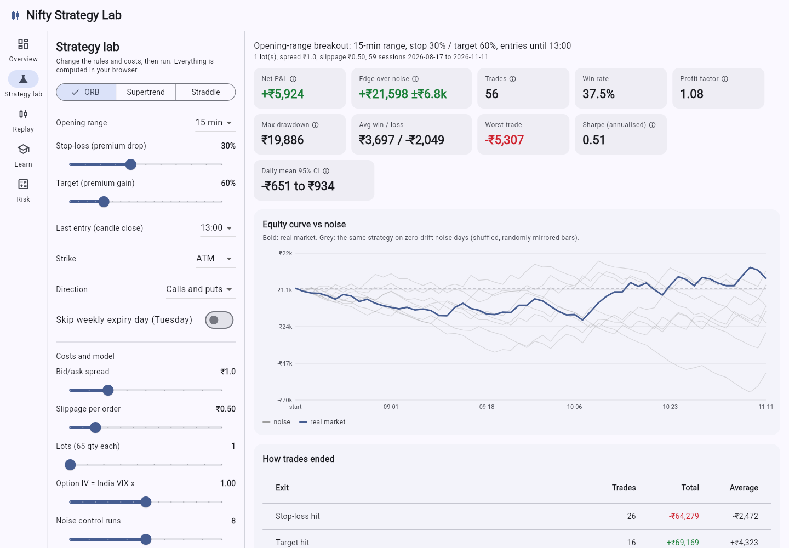
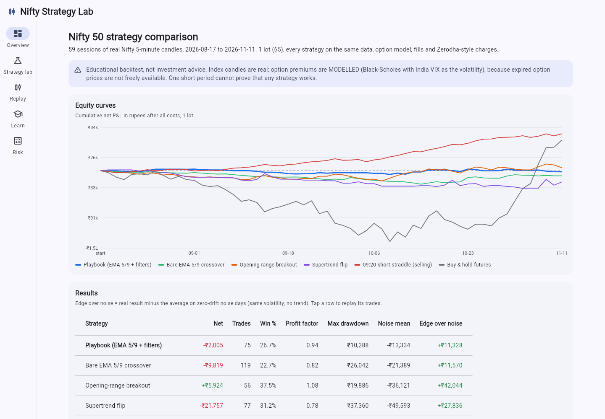
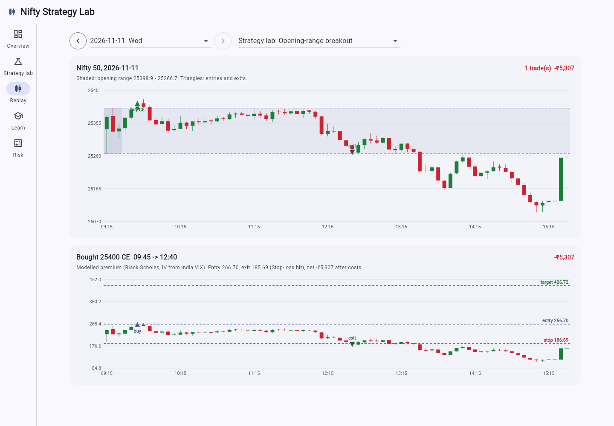

# Nifty Strategy Lab

A Flutter web app that backtests Nifty 50 option strategies **in your browser** on real 5-minute candles.
No server, no login, no broker connection: everything runs locally in the page.

- **Overview**: the playbook vs. opening-range breakout, Supertrend, a 09:20 short straddle, a bare EMA crossover,
  random entries and buy & hold futures, on the same data, option model, fills and costs.
- **Strategy lab**: change the rules (opening range, stop, target, entry window, strike, expiry-day filter, Supertrend
  settings, straddle entry and stop) and the costs (spread, slippage, lots, implied volatility), then run. Every run is
  also repeated on zero-drift *noise* days to show how much of the result is real edge.
- **Replay**: any day's candles with the opening range, entries, exits and the modelled option premium with stop and target.
- **Learn**: how each strategy works and how to read the numbers.
- **Risk**: position size, loss at stop, break-even win rate and losing-streak maths for one trade.



| Overview | Replay |
|---|---|
|  |  |

> Educational tool, **not investment advice**. Index candles are real; option premiums are **modelled**
> (Black-Scholes with India VIX as the volatility, nearest weekly Tuesday expiry, trading-time clock), because
> expired option prices are not freely available. About three months of data cannot prove any strategy works.

## Publish on GitHub Pages

1. Create an empty **public** repository on GitHub (for example `nifty-strategy-lab`).
2. Push this folder:
   ```bash
   git remote add origin https://github.com/<your-user>/nifty-strategy-lab.git
   git push -u origin main
   ```
3. On GitHub: **Settings -> Pages -> Build and deployment -> Source: GitHub Actions**.
4. The workflow in `.github/workflows/deploy.yml` runs the analyzer and all tests, builds the web app with the right
   base path and deploys it. After a few minutes the app is at `https://<your-user>.github.io/nifty-strategy-lab/`.

Every push to `main` redeploys. Pull requests run the tests without deploying. Links can open a tab directly:
`.../?tab=lab`, `?tab=replay`, `?tab=learn`, `?tab=risk`.

## Run locally

```bash
flutter pub get
flutter test
flutter run -d chrome
```

Flutter 3.41 (stable). The app has no third-party packages; charts are drawn with Flutter's canvas.

## How the numbers are produced

| | |
|---|---|
| Spot | Nifty 50 5-minute candles and India VIX (`assets/data/market.json`) |
| Options | Black-Scholes at the bar's VIX (x the IV setting), weekly Tuesday expiry; theta accrues in market hours, a night counts as a quarter of a session |
| Fills | buy at ask + slippage, sell at bid - slippage; inside a candle the stop is checked before the target; a gapped stop fills at the open; a target needs the bid to reach it |
| Costs | brokerage (Rs 20 or 0.03%), STT on sells, exchange, SEBI, GST, stamp duty |
| Noise control | the same bars shuffled and randomly mirrored (same volatility, no trend); edge over noise = real minus the noise average |

The engine in `lib/engine/` is a port of the Python trading bot's backtester. `test/engine_test.dart` checks that, with
default settings, it reproduces the Python results **trade for trade** (same entries, exits and reasons; prices within
1 paisa) for the opening-range breakout, Supertrend and short straddle, both on the real days and on the Python bot's
own noise days. The playbook, EMA-crossover and random-entry rows come from the Python bot's full signal engine
(`assets/data/reference.json`).

Noise runs in the app use Dart's random generator, so individual noise runs differ from the Python ones. One noise run
varies by roughly Rs 20-30k, so the average of 8 runs is only good to about +/- Rs 8-10k (the lab shows this standard
error next to the edge). `dart run tool/noise_check.dart 256` prints the average over many runs.

## Updating the data

The bundled files are produced by the Python bot (kept separately):

```bash
python -m nifty_bot.compare                      # strategy comparison -> reports/compare.json, compare_trades.csv
python -m nifty_bot.export_app_data --out <this repo>/assets/data
```

`market.json` holds every full session; the first session only warms up the indicators.

### Data notice

The candles come from Yahoo Finance's public chart endpoint, whose terms are meant for personal use. Before publishing
the repository, make sure redistributing them is acceptable to you, or replace `assets/data/market.json` with data you
are licensed to share (for example candles recorded from your own broker feed, subject to its terms).
